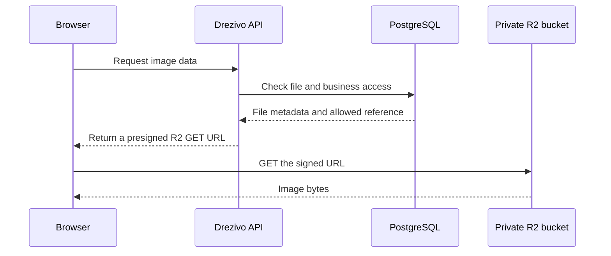
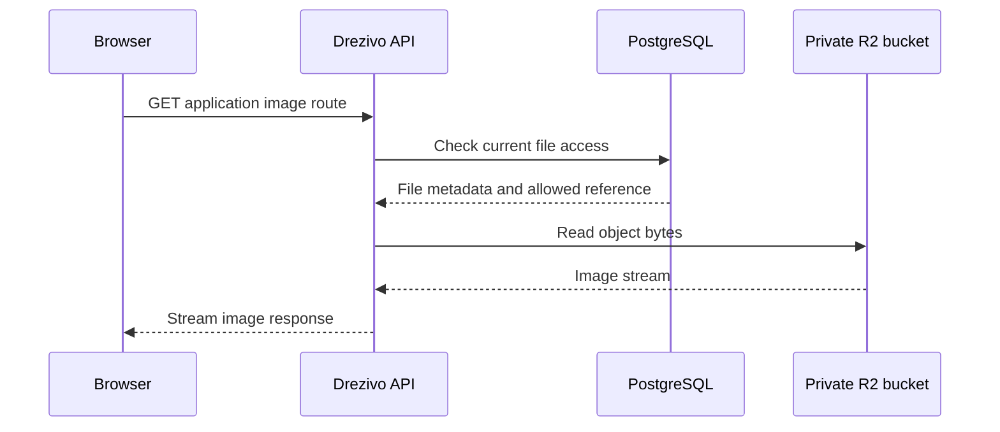
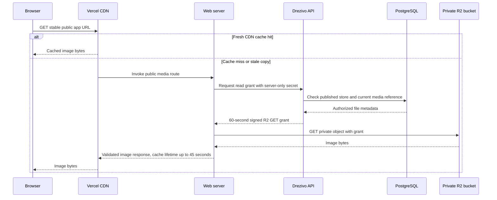

# Object storage and image delivery evolution

**Status:** architecture guide for the implementation in `codex/r2-private-media-proxy`  
**Scope:** object storage foundations and the three browser-facing image-read designs

This guide explains how Drezivo stores uploaded files and how its image delivery design evolved.
It describes the code on the named branch. It does not claim that the branch has been released or
that production is configured the same way.

## Shared storage foundation

The database and object storage have different jobs:

- PostgreSQL stores each file's tenant, purpose, MIME type, size, checksum, lifecycle state, and
  references from business records. Those fields determine whether an application route is allowed
  to offer the file.
- Cloudflare R2 stores the actual bytes. The bucket is intended to stay private; the application
  uses the S3-compatible storage adapter to read and write objects.
- The application creates object keys from server-controlled tenant, purpose, and file identifiers.
  A client does not choose an arbitrary bucket path.

Uploads follow the same pattern in all three read designs. The API authorizes one upload and returns
a short-lived, single-object presigned `PUT` URL. The browser sends the bytes directly to R2 using
that URL. It then asks the API to finalize the upload. The API checks the stored bytes and metadata,
computes its own checksum, validates the content type and file signature, and changes the file's
lifecycle state only after the checks pass. The browser sees a temporary upload URL because it must
send the bytes to R2; it does not receive the R2 secret key.

The designs below concern **reads**, which happen after an object is accepted. They do not change
the database as the owner of authorization state or R2 as the owner of stored bytes.

## Terms used in this guide

| Term | Plain meaning |
| --- | --- |
| Browser | The visitor's or staff member's device and browser. It requests and displays images. |
| API | Drezivo's backend. It checks identity, tenant, permissions, file state, and business references. |
| Web/app server | The server-side part of the public `web` or staff `app` Next.js application. It can call the API and R2 without sending its server secrets to the browser. |
| Object storage | The service that stores file bytes. In production this is the private R2 bucket. |
| Signed URL | A temporary link that authorizes a specific operation on a specific object. Anyone who obtains the link can use it until it expires. It is not the R2 secret key and does not grant bucket listing. |
| Content delivery network (CDN) | A set of servers near users that can serve recently requested public files without contacting the original application servers. Drezivo uses Vercel's CDN for public images. |
| Cache | A temporary copy kept to avoid fetching the same bytes from the source each time. It is not the canonical file. |
| Cache hit | A request finds a fresh cached copy and receives it directly. |
| Cache miss | No fresh cached copy is available. The request goes to the application origin, which checks access and fetches the bytes. A miss can be slower, but it does not mean the image is deleted. |
| Time to live (TTL) | How long a particular signed link or cached copy is valid or considered fresh. A cache TTL does not delete the source image or erase an image already displayed in a browser. |
| Source of truth | The record or service whose value governs copies. PostgreSQL owns file state and references; R2 owns the stored file bytes; a CDN cache is only a temporary copy. |

## Implementation 1: the browser reads a presigned R2 URL

### Flow

The API checks access when it creates the signed URL, then the browser fetches the bytes from R2.
The original example URL supplied during the investigation had a one-hour expiry. The exact TTL is
a configuration choice; the key behavior is that the browser receives the signed link itself.

### Where it fits

This is useful when the simplest and shortest image path matters, such as a small application that
needs to serve accepted files from a private bucket without making the application server carry the
image bytes.

### Benefits and tradeoffs

- R2 sends the bytes directly to the browser, which avoids routing the image body through Drezivo's
  API.
- The bucket can remain private. The URL grants one object operation rather than public access to
  the whole bucket.
- The browser can copy, share, or log the signed URL. It includes the storage host, object path,
  access key identifier, and temporary signature. A recipient can fetch that object until the URL
  expires.
- A signed URL is a bearer credential: the storage provider checks the signature, not the identity
  of the person who later uses the link. Authorization is not rechecked for each GET using that
  same link.
- Once the URL expires, that exact link stops working. The application must return a new link for a
  later read. A displayed image does not vanish merely because its URL expired, but a later fetch
  using the old URL can fail.
- Signed query strings can complicate shared CDN caching because URLs may differ by signature and
  expiry.

The central drawback for Drezivo was not that a signed URL exposes the R2 secret key or grants
bucket-wide access. It does neither. The drawback was exposing storage addresses and temporary read
capabilities to clients, and making the browser-facing URL itself expire.

## Implementation 2: the API streams the image bytes

### Flow

The browser requests an application route. The API authorizes the request, reads the object from R2,
and streams the bytes back. The signed storage operation, if used internally by the storage adapter,
stays on the server side.

### Where it fits

This is useful when each read must pass through one trusted service that can apply authorization,
content checks, audit rules, and response headers before returning bytes. It can also be appropriate
for small or infrequently read private files where an extra delivery layer is acceptable.

### Benefits and tradeoffs

- The browser receives an application URL and image bytes, not the R2 URL or key.
- The API can recheck tenant scope, file purpose, permissions, and current business-record
  references on every request.
- The API becomes part of the image data path. It must keep the request open while R2 sends bytes
  and while the browser receives them.
- Image traffic consumes API network capacity and can increase request latency, bandwidth cost, and
  pressure on API instances. Larger images and many concurrent visitors make this more noticeable.
- The API can become the throughput bottleneck even though R2 is designed to serve object bytes.

This version addressed direct browser exposure, but it also put the API back in the hot path for
every image byte. The next design keeps the API as the authorization authority while moving public
image delivery to the web server and CDN.

## Implementation 3: the web/app proxy, private grants, and CDN

### Shared design

The browser requests a stable application URL. The API decides whether a read is allowed and issues
a short-lived signed R2 GET only to a trusted web or app server. That server fetches and streams the
bytes. The browser receives the application response, not the R2 signed URL.

The API grant is the **control path**: it answers whether this file can be read. The server-to-server
R2 request is the **byte path**: it obtains the image bytes. For public images, Vercel's CDN can
serve those bytes after the first successful read without repeating either path while its copy is
fresh.

### Public storefront flow

1. Storefront data contains a stable URL such as
   `/api/media/public/{slug}/{fileId}?w=960` on the `web` origin. The URL identifies an application
   route and a file ID, not an R2 object key or signature.
2. The browser requests the URL. A fresh CDN cache hit returns the image immediately.
3. On a cache miss, the web route requests a grant from the API using a server-only shared secret.
4. The API checks the published store, tenant, accepted and frozen file, allowed purpose, and
   current reference from published content. Examples include storefront branding and policy
   images, active catalogue products, active measurement guides, and ready online payment-method
   media.
5. The API looks for the requested private WebP derivative and falls back to the accepted source
   image if the derivative is absent. It signs one R2 GET URL for 60 seconds and returns metadata
   and the signed URL to the web server.
6. The web server validates the grant response and R2 host, fetches and validates the bytes, then
   streams the image to the browser. The public image response is cached at Vercel for up to 45
   seconds and tagged for invalidation.

The browser response asks the browser to revalidate its stable URL, while Vercel may keep a fresh
public copy for up to 45 seconds. When a database change affects public media, an outbox event lets
the worker request deletion of that tenant's tagged CDN entries. If invalidation is delayed, the
45-second cache lifetime is the fallback. A cache TTL is not a timer that removes an image from an
open page, and it does not expire the stable app URL. On a later request after a cache miss, the
route obtains a new R2 grant if the image remains authorized.

### Preview flow

Preview uses `/api/media/preview/{slug}/{fileId}`. The web server forwards the HttpOnly preview
token to the API. The API verifies that the token allows preview of that store and checks the file
reference. The web server fetches the object using a short-lived grant, but the preview response is
`private, no-store`, so draft images are not put in the public CDN cache.

### Staff flow

The staff app uses `/api/media/staff/{fileId}` on its own origin. Its server obtains the Clerk token
and sends it with the selected branch to the API. The API verifies staff authentication and tenant
context, then checks purpose-specific permissions and the current record reference. For example,
payment receipt access is tied to an authorized reservation and branch. The API issues a short-lived
R2 grant; the app server fetches and streams the bytes. Staff responses are `private, no-store`.

The same-origin URL is not the authorization decision. The API is. Knowing a file ID or route does
not bypass the server-side tenant, branch, purpose, and permission checks.

### Image derivatives

After an eligible image is accepted, an outbox job asks the worker to generate private WebP versions
at widths of 320, 960, and 1600 pixels. New acceptances enqueue work transactionally; migration
`0080_file_image_variants_backfill.sql` queues eligible existing images. Until a requested version
exists, reads use the accepted source image. The API grants the variant only when its stored type
and size are valid. The variants stay in the private bucket and use tenant-scoped keys.

### Benefits and tradeoffs

- The main public and staff routes do not put R2 read URLs or object keys in browser responses.
- The API checks business authorization but does not stream the image body. This removes the API
  from the main byte path.
- A fresh public CDN hit avoids a web function, API grant request, and R2 read. This is where the
  design gains the most speed for frequently requested images.
- A cold cache miss still calls the web server, API, and R2. It can be slower than a direct signed
  URL for that first request.
- Preview and staff responses are not cached publicly. Their authorization is checked again when
  the application route is requested.
- Public image bytes remain public by design. Hiding the R2 address does not prevent a visitor from
  viewing, saving, or sharing an image that the storefront is allowed to display.
- The design adds server-only grant secrets, cache tags, invalidation jobs, CDN configuration, and
  image-derivative processing. These components need monitoring and matching environment
  configuration.

### Remaining direct-URL exception

The branch still returns direct five-minute presigned R2 GET URLs for shared renter-payment-step
images and legacy conflicting renter-step images. The API helper accepts only explicitly supplied,
same-tenant files with purpose `payment_method_material`, accepted and frozen lifecycle state,
allowed image types, and a bounded size. The staff payment-settings response uses this helper. The
guest reservation view uses it only while the reservation is payable, and that view is protected by
the reservation access flow.

This exception is not a payment receipt or verification document. Payment receipts use the staff
authorization flow above. Still, anyone who obtains a renter-step signed URL can fetch that one
object until the five-minute grant expires. If the browser later tries the expired direct URL again,
it needs a fresh API response to obtain a new one. An image already displayed does not disappear
when that URL expires.

The API also uses a signed read internally for catalogue-photo extraction. That URL is fetched by
the API service and is not returned to the browser.

### How the designs improved

| Design | Primary improvement | Why it was not the final answer |
| --- | --- | --- |
| Direct presigned GET | R2 serves bytes directly with a short path | The browser receives a reusable, expiring R2 bearer URL. |
| API byte-stream proxy | The browser no longer needs an R2 URL; API can authorize each read | Every image body passes through the API, increasing latency and API bandwidth. |
| App proxy and CDN | Signed R2 grants stay server-to-server; public cache hits bypass API and R2 | Cold misses still take multiple server requests; preview and staff reads do not receive public CDN caching. |

The current design separates two concerns: the API remains the source of authorization decisions,
and the web/app server or CDN handles delivery. It is a better balance for the main image paths, but
the renter-payment-step exception means the branch does not yet satisfy a blanket rule that browsers
never receive signed R2 GET URLs.

## Security and operating boundaries

- Keep R2 public access, `r2.dev`, and unintended public custom domains disabled. If a public R2
  endpoint is enabled, a caller may bypass application checks by using that endpoint directly.
- Keep R2 credentials and `MEDIA_READ_GRANT_SECRET` in server-side environment configuration only.
  Do not expose them through `NEXT_PUBLIC_*`, browser JSON, URLs, logs, or documentation examples.
- Treat a signed URL as a temporary credential. Do not log or paste real signed URLs, object keys,
  or secret values into issues or chat.
- Keep private evidence on staff routes with purpose-specific tenant, branch, permission, and record
  checks. A file's accepted status alone does not make it public.
- A public image route is an access-controlled way to reach intentionally public content. It is not
  a confidentiality mechanism for the image bytes.

## Implementation references

- Public grant and storefront eligibility: [`internal-media.routes.ts`](../../api/src/modules/internal-media/internal-media.routes.ts), [`storefront.repository.ts`](../../api/src/modules/storefront/storefront.repository.ts)
- Signed grants and image variants: [`file-read-grant.ts`](../../api/src/modules/files/file-read-grant.ts), [`file-image-variants.ts`](../../api/src/worker/handlers/file-image-variants.ts)
- Public and staff delivery: [`web media proxy`](../../web/src/lib/media-proxy.ts), [`app media proxy`](../../app/src/lib/media-proxy.ts)
- Direct renter-step exception: [`payment-renter-steps-media.ts`](../../api/src/modules/files/payment-renter-steps-media.ts), [`guest-booking.service.ts`](../../api/src/modules/guest-booking/guest-booking.service.ts), [`payment-methods.service.ts`](../../api/src/modules/payment-methods/payment-methods.service.ts)
- Cache invalidation: [`media-cache-invalidation.ts`](../../api/src/worker/handlers/media-cache-invalidation.ts), [`web invalidation route`](../../web/src/app/api/media/invalidate/route.ts)
- Operational configuration and rollout: [`private-media-delivery.md`](../runbooks/private-media-delivery.md)
